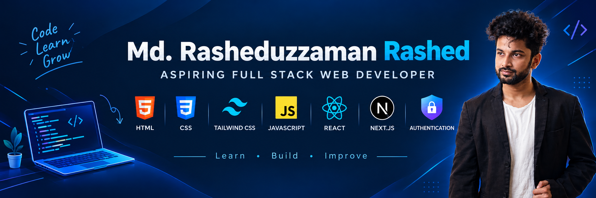

  

<h1 align="center">Hi 👋, I'm Rashed</h1>
<h3 align="center">A passionate full stack web developer from Bangladesh 🇧🇩</h3>

  

---

### 🚀 About Me

- 💻 I'm learning and building modern, responsive web applications
- 🔐 I enjoy working with authentication and secure user flows
- 🌱 Currently sharpening my skills with **React** and **Next.js**
- 🎯 Goal: become a confident full stack web developer

---

### 🛠️ Skills

  
  

| Frontend | Framework / Library | Other |
| :------: | :-----------------: | :---: |
| HTML5 | React | Authentication |
| CSS3 | Next.js | |
| Tailwind CSS | | |
| JavaScript | | |

---

### 🤝 Connect with me

---

### 📊 GitHub Stats

  
  

  

  <i>Learn • Build • Improve</i> ✨

